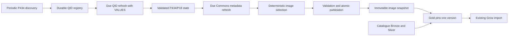

# Independent artist image enrichment

Status: approved architecture; implementation plan, 2026-11-05.

This document plans code, configuration, migration tooling, and staging validation. It does not authorize deployment, a production change, a release, or a version bump. Proposed paths and configuration names below are implementation targets, not existing interfaces.

## 1. Problem and decision

Artist image enrichment has a different availability and freshness requirement from the music catalogue, but currently shares its execution and failure boundary. The design flaw is that a refreshable, optional enrichment is a prerequisite for building the catalogue, and Gold reads its mutable intermediate output as if it were a published dataset.

Create an independently scheduled artist image job in the existing `wikidata` package. It owns the complete chain: Wikidata artist discovery, P434/P18 refresh, Commons attribution and licence metadata, deterministic image selection, validation, and snapshot publication. Gold consumes one immutable, validated snapshot pinned at the beginning of its build.

Use the existing Python/Polars/Parquet stack and systemd. No database, new service, or orchestration platform is required at the observed scale. Keep the current Grow artist image JSON contract.

### Evidence and limits of the diagnosis

The staging observations below belong to the 2026-11-05 incident; they are not a statement about the current VPS state.

| Observation | Consequence |
| --- | --- |
| `ingest_artist_images` took 641.4 seconds, from 11:48:00 to 11:58:41 CET, with five timeout warnings before succeeding. | Retries recovered this run, while image extraction added over ten minutes to its Wikidata chain. |
| 137,953 rows were received; five were rejected; 137,948 were written. | The reject rate was about 0.0036%, below the existing 1% ceiling. This was not the main problem. |
| All written rows had this stage's `fetched_at`; the preceding image extraction was less than an hour old. | The job repeated its complete extraction despite having a recent usable cache. |
| The extractor already has 16 MBID-prefix partitions and a 300-second retry budget per query. | “Add chunks” alone would repeat an existing mechanism. Change how work is selected and bounded. |
| The resulting data contained 129,980 QIDs and 134,669 distinct QID/MBID pairs. Of those pairs, 14,454 were absent from MusicBrainz's Wikidata links. | MusicBrainz links cannot define the complete discovery universe. |
| Timeout bodies varied from megabytes to 32 KiB. | Payload size cannot distinguish source load, query cost, or network effects. |

Eventual success does not prove the query is inexpensive, and the logs do not prove WDQS overload. The proposal addresses both variable remote availability and repeated broad extraction. The earlier retry/cache fix, [PR #268](https://github.com/BehindTheMusicTree/the-music-tree-pipelines/pull/268), remains relevant but does not provide incremental scheduling or an independent publication boundary.

The existing main run was observed progressing beyond artist images. Completion through Gold was not verified in that diagnosis.

## 2. Baselines and ownership

Both remotes were fetched before planning and rechecked before implementation:

| Repository | Integration branch | Reviewed commit | Responsibility |
| --- | --- | --- | --- |
| `the-music-tree-pipelines` | `origin/develop` | `f84d89e` (original review `c692178`) | Extraction, refresh state, image selection, snapshot contract, Gold consumption, tests and data documentation. The intervening change only deduplicated changelog entries. |
| `infrastructure` | `origin/main` | `bfc7389da0f674c76ef4f0d28d589640097c7eb5` | Isolated runtime, environment wiring, locking, systemd scheduling, resource controls and operational documentation. |

Relevant existing implementation:

- `pipelines/wikidata/src/wikidata/ingest.py`: image extraction runs inside `_ingest_sparql_lane`; successful partitions are not checkpointed independently.
- `pipelines/wikidata/src/wikidata/wikidata_client.py`: prefix-filtered P434/P18 queries, WDQS retry classification and budgets.
- `pipelines/wikidata/src/wikidata/silver/__main__.py`: Commons metadata and final image selection run after genre steps in both full and curation workflows.
- `pipelines/wikidata/src/wikidata/silver/commons_image_metadata.py`: 50-file batches, 30-day cache TTL, partial progress written in `finally` to a mutable file.
- `pipelines/wikidata/src/wikidata/silver/artist_images.py`: current eligibility rules and stable selection, producing `11_artist_images.parquet`.
- `pipelines/gold/src/gold/artist_export.py`: mandatory scan of that mutable file, followed by a left join onto artists.
- `pipelines/gold/src/gold/build.py`: build orchestration and completion manifest, written last.
- `pipelines/gold/src/gold/delta_export.py`: artist changes are compared by stored column values, including the image; this is not a hash-based delta contract.
- Infrastructure `music-tree-pipelines/scripts/run-music-tree-pipelines.sh`: catalogue lock, code update, full/curation/sync modes and Grow imports.
- Infrastructure `ansible/roles/music_tree_pipelines/tasks/setup_env.yml`, `defaults/main.yml`, and `music-tree-pipelines/scripts/setup-music-tree-pipelines-systemd.sh`: current checkout, environment and unit configuration.

Re-check these baselines before implementation. Each implementation task gets its own worktree; pipelines PRs target `develop`, infrastructure PRs target `main`.

## 3. Required invariants

1. A WDQS or Commons refresh outage cannot invalidate an already published image snapshot or stop catalogue construction from that snapshot.
2. Missing configuration, an absent initial snapshot, an unsupported schema, or a corrupt selected snapshot fails explicitly. There is no silent empty-image fallback.
3. Gold resolves the image snapshot once, before building any exports, and reads that exact version throughout the build.
4. A published snapshot is immutable and self-contained. Intermediate cache files are never consumer inputs.
5. A successful response updates only the QIDs/files it completely covers. A timeout, parse failure, omitted continuation page, or rejected QID response never means “image removed”.
6. `publishedAt`, per-QID claim check times, per-file metadata check times, and discovery completion time have distinct meanings.
7. Discovery preserves Wikidata's P434 scope, including entities without an image or a MusicBrainz Wikidata backlink. Gold retains its existing consumer artist scope.
8. P434 and P18 keep their current `wdt:` best-rank semantics; multiple best-ranked MBIDs/images remain supported.
9. Confirmed source changes remove ineligible associations and images. Old cache entries cannot override a newer successful negative or non-free result.
10. Refresh progress survives process termination, and resume does not pretend that unfinished work succeeded.
11. An image worker never updates the catalogue checkout or its virtual environment. There is one image-state writer per environment.
12. Image publication does not launch a catalogue build, create a Grow pipeline request, or import artists directly. The next normal Gold build propagates changes.

## 4. Target flow



The materialized snapshot is coherent across its recorded input state, but it is not a transactionally simultaneous view of Wikidata and Commons. Its provenance must state the actual observation times.

### Commands and module boundaries

Add `wikidata.artist_images` as a package with a command entrypoint:

```sh
uv run --frozen --no-sync --package wikidata python -m wikidata.artist_images refresh
uv run --frozen --no-sync --package wikidata python -m wikidata.artist_images discover
uv run --frozen --no-sync --package wikidata python -m wikidata.artist_images bootstrap --source-bronze <path> --source-silver <path>
uv run --frozen --no-sync --package wikidata python -m wikidata.artist_images status
```

`refresh` processes due work and publishes if valid. `discover` commits a complete registry discovery result. The scheduled wrapper performs discovery only when due, then refreshes; a discovery failure is reported separately and does not prevent refreshing previously known QIDs. `bootstrap` is an explicit one-time migration command. `status` is read-only and checks publication integrity and freshness.

Suggested focused modules under `wikidata/artist_images/`: `__main__.py`, `config.py`, `discovery.py`, `refresh.py`, `state.py`, `publish.py`, and `bootstrap.py`. Reuse or relocate the existing Commons parser/client and image selection functions; do not duplicate their rules. Separate pure frame transformations from path-based wrappers so both migration and new refresh use the same selection logic.

Put the minimal shared snapshot manifest model and resolver in `pipelines/common/src/common/artist_image_snapshot.py`. Wikidata owns publication; Gold uses the shared resolver without importing the Wikidata package. Do not build a generic workflow or artifact framework.

## 5. Storage and data contracts

Use a dedicated root per environment, outside both code checkouts. Proposed layout:

```text
<env-data>/artist-images/
  state/
    base/<generation>/
      registry.parquet
      claims.parquet
      commons.parquet
      manifest.json
    checkpoints/<run-id>/<batch-id>/
      data.parquet
      manifest.json
    current.json
  snapshots/<snapshot-id>/
    artist_images.parquet
    lineage.parquet
    manifest.json
  staging/<run-id>/
  current.json
  status.json
```

`state/current.json` and the root `current.json` serve different purposes: the former identifies recoverable internal refresh state; the latter identifies the public snapshot. A state checkpoint is never a publication.

### Registry: one row per canonical QID

Persist at least:

| Field | Meaning |
| --- | --- |
| `item_id` | Canonical QID, validated as an item identifier. |
| `first_seen_at`, `last_seen_in_discovery_at` | Observation history; failed discovery does not advance it. |
| `claims_checked_at` | Last fully successful P434/P18 observation for this QID; nullable when only discovered. |
| `claims_status` | `unfetched`, `has_image`, `no_image`, `no_mbid`, or `missing`; transport errors are tracked separately. |
| `next_check_at` | Due time derived from the last valid result and policy version. |
| `last_attempt_at`, `consecutive_failures`, `retry_after_at` | Operational retry state, without changing successful freshness. |

Persist redirects in a separate alias mapping or equivalent typed table; do not lose the requested QID when replacing it with its canonical target. Define how two registry rows merge before implementing redirect support.

### Claims: long form

Keep one row per valid `(item_id, musicbrainz_artist_id, image_file)` association, with `claims_checked_at`. Store the registry result even when it produces zero association rows, so negative observations are cacheable. Refreshing a QID replaces its complete association set only after validating the whole result for that QID.

Normalize MBIDs and Commons filenames exactly as today. Keep all valid P434/P18 combinations. Do not deduplicate by MBID before final selection. Preserve original evidence and reject reasons in bounded diagnostics, without storing multi-megabyte error bodies in logs.

### Commons cache: one row per requested file identity

Reuse the current metadata fields: file, thumbnail URL, description page URL, author, licence, licence URL, attribution requirement, non-free flag and `checked_at`. Add explicit result status so a confirmed missing file differs from an unparseable response or API error. Retain requested-to-canonical title mappings for normalization and redirects.

A successful negative result advances `checked_at`; a failed response does not. Shared image files are checked once and reused across every associated artist. Do not discard metadata for files merely because one refresh batch temporarily has no reference to them.

### Published image rows

Keep the current six-column contract, one row per MBID:

```text
musicbrainz_artist_id: String, unique, non-null
thumb_url: String, non-null
page_url: String, non-null
author: String, nullable only when attribution is not required
license: String, non-null
license_url: String, nullable
```

Retain current eligibility checks: non-free files excluded, required attribution present, valid URL domains/schemes and the 2,048-byte URL ceiling. Preserve the current stable choice by sorting MBID and filename; define deterministic tie handling when different QIDs refer to the same file. An unavailable candidate must not cause unrelated artists or songs to disappear.

Keep timestamps and QID/file provenance in `lineage.parquet`, keyed by MBID. It records the selected QID/file, `claims_checked_at`, and `metadata_checked_at`; it does not change Grow's JSON schema. Lineage must describe only the selected association, with conservative timestamps if duplicate evidence has different ages.

### Snapshot manifest v1

The manifest records:

- `schemaVersion`, `snapshotId`, `publishedAt`, `producerCommit`, `policyVersion`, and source state generation.
- For each allowed artifact: fixed relative filename, SHA-256 and row count. Paths cannot escape the snapshot directory.
- Registry discovery completion time and whether the registry is a bootstrap seed or a complete P434 discovery generation.
- Selected image count, distinct source QID/file counts, rejects and removals by reason.
- Actual claim/metadata age summaries, including overdue counts and oldest successful check times.
- Refresh coverage: attempted, succeeded, deferred and failed QIDs/files. A bounded run completing is not a claim that the whole source was refreshed.
- Bootstrap provenance where applicable, including hashes and original observation times of imported files.

The root pointer contains only a supported pointer version and snapshot ID. Snapshot IDs are collision-resistant unique generation IDs, with hashes in the manifest; timestamps alone are insufficient. A separate content digest may detect unchanged selected image data without confusing unchanged content with unchanged freshness.

The draft v1 resolver names the provenance fields `sourceStateGeneration`, `discovery` (`coverage` is `bootstrap_seed` or `complete`, with nullable UTC `completedAt`), `selectedImageCount`, `sourceQidCount`, `sourceFileCount`, `rejectsByReason`, `removalsByReason`, `ageSummary`, `refreshCoverage` and `sourceValidation`. The source counts refer to distinct QIDs and files in the selected lineage. Each age summary has `overdueCount` and nullable UTC `oldestCheckedAt`; each coverage summary has `attempted`, `succeeded`, `deferred` and `failed` counts, separately for `claims` and `metadata`. Bootstrap provenance names all three captured legacy files and records each SHA-256 and nullable `observedAt`; unknown observations stay null. `sourceValidation` records `inputRows`, `rejectedRows`, and a `failed` flag. The publisher blocks source failures, rejects above 1%, and any selected-artist loss above 5%, including confirmed loss, pending investigation. The future worker must supply these counts and per-removal evidence from validated source observations.

## 6. Discovery, incremental refresh and freshness

### 6.1 Discovery without narrowing the source universe

Start the registry with every QID in the last validated image Bronze file. Expand it through a periodic P434-only extraction, including QIDs that currently have no P18:

```sparql
PREFIX wdt: <http://www.wikidata.org/prop/direct/>
SELECT ?item WHERE {
  ?item wdt:P434 ?mbid .
}
```

This avoids the global P434/P18 join and image payload. Deduplicate QIDs locally. Do not add a label service, global sort, `OFFSET`, MBID-prefix text filter, or a MusicBrainz-only restriction. A partial response is never committed as a completed discovery generation. Discovery adds candidates; omission from a discovery result alone does not delete known QIDs.

**Feasibility gate:** before selecting the complete P434-only request as the operational discovery source, capture its plan, complete row count, response size and elapsed time from a small number of spaced observations. Target completion below 30 seconds under ordinary conditions, with margin below WDQS's deadline. A complete JSON response and local validation are necessary, but do not establish a global point-in-time completeness guarantee.

On 2026-11-05, one local GET returned HTTP 200 in 10.10 seconds, with a 41,019,230-byte JSON response containing 346,479 rows and 336,358 distinct valid QIDs. This single response may have been served from a cache; it is neither a sustained throughput measurement nor proof of point-in-time completeness. A subsequent `explain=details` request returned HTTP 429, so further requests stopped. The gate remains open: capture plans and spaced observations while respecting throttling before claiming operational feasibility.

If it repeatedly cannot finish within the provider limit, keep the seeded registry and known-QID refresh working, report discovery as degraded, and stop this discovery implementation at the gate. Evaluate a periodic official dump-derived P434 index as a separate acquisition decision with measured storage, download and processing cost. Do not silently reduce coverage to MusicBrainz links, introduce a third-party endpoint, or pretend textual pagination is bounded indexed access. This gate is an explicit remaining empirical question, not a resolved performance claim.

Discovery commits its registry generation independently. A failed discovery preserves its last completed generation; the scheduled wrapper can still perform known-QID refresh and publish valid changes, while returning a degraded status that alerts on discovery age.

### 6.2 QID refresh with explicit bounds

Use explicit QIDs with an initial maximum batch of 1,000, based on the existing claims-step pattern. Return an observation for every requested QID, including negative results. A suitable query shape to validate is:

```sparql
PREFIX wd: <http://www.wikidata.org/entity/>
PREFIX wdt: <http://www.wikidata.org/prop/direct/>
SELECT ?item ?mbid ?image WHERE {
  VALUES ?item { wd:Q... wd:Q... }
  OPTIONAL { ?item wdt:P434 ?mbid . }
  OPTIONAL { ?item wdt:P18 ?image . }
}
```

Validate the actual query plan and negative-result behavior; the sample measurements used a stricter positive-only join. Validate RDF term types and Commons file URLs locally. Preserve the outer QID observation when a property has no usable value. Unknown-value nodes are not Commons filenames.

Three local samples of 1,000 already-known positive QIDs completed in approximately 15.9, 4.9 and 2.4 seconds. Those observations justify trying bounded QID batches; they are not an SLO, a VPS benchmark, or a test of discovery, redirects, removals or the proposed optional-property query.

On 2026-11-05 a POST using the optional query for 1,000 QIDs selected from the discovery response returned HTTP 200 in 4.87 seconds, 308,518 bytes, 1,060 rows and all 1,000 requested QIDs; 675 rows had no P18. A separate three-QID GET returned a positive row, a row without P434, and a row with neither property, in 32.04 seconds. These are limited functional samples, not representative timing distributions or confirmation that absent entities can be distinguished from missing claims. The query plan and redirect/deletion confirmation behavior remain to be measured.

Processing rules:

1. Build a stable due queue from persisted success timestamps, retry deferrals and QID order. Queue membership is QID-based, never “only rows returned by the last successful query”.
2. Reserve at least half the available QID capacity for oldest overdue existing entries when a large influx of new QIDs exists. Use the remainder for never-checked entries. Unused capacity transfers between these groups.
3. Validate response structure and coverage of every requested QID. Commit only complete, valid per-QID replacements. Quarantine malformed QID results without replacing their previous associations or advancing their success timestamp.
4. Confirm no-P434/deleted/redirect cases through the existing Wikidata entity API in batches of at most 50 where needed. Resolve redirects explicitly; cache their canonical target. API failures do not establish deletion.
5. A valid no-P18 result removes the QID's old image associations and records a negative result. Retain the QID for future checks so a later image can be discovered.
6. If invalid rows affect a QID, keep its prior complete association set until a clean observation; the row reject budget does not authorize partial destructive replacement.
7. Checkpoint each accepted batch before requesting another. Use a monotonic overall deadline, checked before a request, a retry, or a split.

If a batch times out, allow one transient retry with jitter; if it still fails, halve it deterministically, down to 50 QIDs. The original batch, all split descendants, retries, lock waits and backoff share one 90-second monotonic deadline, as well as the run/request budgets. Do not start a request whose deadline would exceed the remaining family or run budget. After three consecutive provider-wide failures, open a circuit for that provider and stop issuing more requests for the run. Do not recursively multiply retry budgets. HTTP 429 honors `Retry-After` and never triggers bisection. Permanent 4xx/configuration errors fail immediately.

Use a 30-second client deadline as an initial image-query bound. Existing catalogue WDQS queries keep their current behavior; introduce image-specific retry/budget parameters rather than changing all callers of `run_query`. Distinguish `WdqsTimeout`, transport errors and malformed responses when evidence permits; do not label every invalid JSON response a proven server timeout.

### 6.3 Commons refresh

Refresh distinct files referenced by current claims. Keep the 50-file batch size, standard 500-pixel thumbnail width, HTML-to-text attribution parsing, URL cleanup and continuation handling.

- Prioritize newly referenced files, while reserving capacity for oldest overdue metadata so a new-file backlog cannot starve existing images.
- A batch is complete only after all continuation pages have been received and title mappings resolved. A missing page in an incomplete response is not a missing file.
- A confirmed missing/non-free/unattributable file invalidates that candidate for the next snapshot, even if an older cache row was usable.
- An API/transport/parser failure preserves the last valid row and its original successful timestamp.
- Bound retries and honor provider throttling and `Retry-After`; do not retry permanent request errors.

### 6.4 Initial policies and budgets

These are explicit initial engineering policies, to be calibrated in staging. They are not promises about a public service.

| Policy | Initial value | Meaning |
| --- | --- | --- |
| Refresh schedule | Every six hours, with per-environment offset and jitter | No-op cheaply when nothing is due. |
| Global discovery | Due every seven days | Independent from known-QID refresh. A newly added P434 item may therefore wait roughly seven days plus the next Gold cycle. |
| Positive claim refresh | Due after seven days | Recheck known image and MBID associations. |
| Negative claim refresh | Due after 30 days | Avoid recrawling all image-less entities daily; a new P18 on a known negative may wait roughly 30 days plus the next Gold cycle. |
| Commons successful metadata | Due after 30 days | Retains the current metadata refresh interval. |
| Confirmed missing Commons file | Due after seven days | Allows restored/newly uploaded files to become eligible sooner. |
| Image WDQS batch | At most 1,000 QIDs, minimum split 50 | Calibrate from optional-query tests. |
| Per-run WDQS attempts | At most 64 HTTP attempts | Includes discovery, retries and split children, not just successful batches. |
| Per-run Wikidata entity API attempts | At most 64 HTTP attempts | Includes confirmations, redirects and retries; each request contains at most 50 QIDs. |
| Commons budget | At most 400 HTTP attempts per run | Includes retries and continuation requests. A normal successful 50-file call can cover up to 50 files. |
| Per-query family time | At most 90 seconds, subject to the overall deadline | One deadline shared by the original request, retries and every split descendant. |
| Overall refresh wrapper budget | 45 minutes | Discovery, locks, backoff, refresh and publication all consume it. Reserve time to validate/publish. |
| systemd oneshot timeout | 50 minutes; stop grace 30 seconds | Outer guard beyond the controlled application deadline. |

Use explicit UTC schedules, for example staging at 01:30/07:30/13:30/19:30 UTC and the other environment at a distinct configured offset. Actual timer enablement is separate from configuration. Check normal catalogue timings before choosing the final offset; the lock protocol handles manual and unexpectedly long runs.

Refresh TTLs mean “due for another check”, not “discard known-good data”. **There is no automatic hard expiry of the last validated snapshot in this change.** Gold continues using it during an outage, with visible age/degradation alerts. A newer confirmed negative/non-free result takes precedence immediately on successful publication. This preserves the current Commons stale-cache availability behavior; it deliberately replaces the old Bronze seven-day fallback that could fail the entire catalogue.

Do not imply that cached metadata proves present-day licence status. If the product later requires a strict serving-age cutoff, define the optional-image degradation policy separately; do not introduce an undocumented cutoff that fails the catalogue or silently republishes an empty dataset.

## 7. Checkpoints and publication transactions

### Internal progress

Use immutable per-batch Parquet checkpoints with a small manifest containing input identifiers, successful observation time, result status, schema version and checksum. Write data and manifest in a temporary batch directory, flush them, then rename that directory into the committed checkpoint area on the same filesystem.

On restart, load the last compacted base plus committed checkpoints. Ignore incomplete temporary directories. Replay by a stable committed sequence; retries are idempotent replacements of explicitly covered QIDs/files, not append-only duplicates. Compact into a new base generation once per phase/run; atomically switch the state pointer only after validating that generation. Never rewrite an existing base generation.

This keeps successful progress without rewriting the whole cache after every 50-file call. Keep implementation local to this job and test interrupted checkpoint/compaction recovery. SIGTERM should stop starting requests and retain committed batches; correctness cannot depend on a signal handler finishing during SIGKILL.

### Public snapshot transaction

1. Assemble a candidate from committed state, with all source success timestamps preserved.
2. Write `artist_images.parquet`, `lineage.parquet` and `manifest.json` in a private staging directory on the publication filesystem.
3. Validate schema, unique MBIDs, required attribution, URL rules, checksums, lineage coverage and source-policy invariants.
4. Apply reject and change-volume gates. Preserve the current 1% row reject ceiling. Reject a candidate with more than a 5% unexplained loss of selected MBIDs relative to the current snapshot. Confirmed source removals are counted separately and require per-QID/file evidence; an unexpectedly large confirmed removal still requires investigation before automatic publication.
5. Flush files and directory metadata, then atomically rename the complete candidate to `snapshots/<id>`.
6. Write and flush a temporary root pointer, atomically replace `current.json`, then flush its parent directory. The pointer switch is the publication event.
7. Write operational status separately; status-report failure must not make an already published version appear unpublished.

The publisher never replaces files inside an existing snapshot. A failure before the pointer switch leaves the previous snapshot selected. A crash after the switch exposes a complete validated version. An unreferenced complete candidate is harmless and can be inspected later.

Budget exhaustion or catalogue contention is a planned partial refresh, not false source success. It may publish a valid mixture of refreshed and preserved entries with explicit coverage. An exhausted provider failure, validation failure or corrupt internal state suppresses that refresh's publication; committed progress survives for the next run. Discovery failure is its own transaction and can coexist with a successful known-QID publication.

### Retention

Initially retain all published snapshots and bases needed for recovery; do not implement automatic deletion as part of the first cut. This grows without bound: monitor free space and growth rate, alert before the filesystem fills, and provision capacity based on measured staging output before enabling the timer. A failed write must leave the current pointer intact. Future garbage collection must protect the current pointer, snapshots referenced by retained Gold manifests, and active reader pins before deleting anything. This avoids a retention race during Polars' deferred reads.

## 8. Gold integration and external behavior

Add required `ARTIST_IMAGES_PUBLISHED_DIR` configuration to Gold. At the start of `build_gold`, after invalidating the old Gold completion manifest and before exporting any dataset:

1. Read the publication pointer once, or resolve an explicitly requested snapshot ID for a reproducible rebuild.
2. Validate pointer/manifest versions, fixed artifact names, file hashes, schemas and selected row count.
3. Resolve immutable absolute paths and pass an explicit `artist_images_path` to `export_artists`.
4. Keep the resolved manifest/provenance object for the whole build. Never pass a mutable pointer/symlink path to `scan_parquet`.
5. Add `artistImagesSnapshot` provenance to Gold's `_manifest.json`: snapshot ID, image artifact digest, producer commit and source observation summary. Keep existing fields and the written-last completion rule.

Support a deliberate `ARTIST_IMAGES_SNAPSHOT_ID` override for a known version; absence means “resolve current at build start”, not a missing-configuration fallback. An invalid override fails. The publication root remains mandatory in either case.

| Workflow | New image behavior |
| --- | --- |
| Image refresh | Updates internal image state and may publish an image snapshot. Does not call Grow. |
| Full catalogue | Wikidata Bronze/Silver omit artist image network calls; Gold pins the published image snapshot. |
| Curation catalogue | Rebuilds genre/curation outputs and Gold against a pinned image snapshot; no image API work. |
| Sync only | Uses existing complete Gold artifacts and recorded provenance; never repins or rebuilds images. |
| Rebuild with explicit image version | Uses that exact immutable version and records it in the new Gold manifest. |

Keep images as a left join. An artist without an eligible image still exports with `image: null`; songs and artists are not dropped. Image additions, replacements, attribution changes and image removals must appear in the existing artist delta comparison. A timestamp-only refresh must not generate artist upserts.

No Grow/frontend schema change is expected. Verify that the infrastructure manifest readers tolerate the additional provenance field; keep it local if a strict consumer is discovered. Do not add an API/frontend task without evidence of a contract dependency.

## 9. Runtime isolation, locks and resource controls

### Separate code and environment

Provision `<env-root>/artist-images/repo` with its own `.venv` and only the configuration required by this job. The existing catalogue checkout remains separate. Both have independent, auditable resolved commits, recorded in their outputs. For staging, the image runtime follows the configured integration ref on its own update path.

Acquire the image writer lock before updating its checkout, syncing dependencies or touching state. Use `git pull --ff-only` and frozen dependency installation; a failed update exits before refresh, leaving the published snapshot intact. During execution use `uv run --frozen --no-sync` so startup cannot modify a virtual environment underneath a running process. Verify the appropriate workspace sync invocation against `uv.lock`; no dependency/version migration is needed.

No MusicBrainz database access, YouTube key, Grow token, curation fetch, or MusicBrainz Docker submodule is required by this worker. Keep secrets out of logs and avoid copying the catalogue's complete environment into it.

### Lock protocol

Use a small explicit lock hierarchy with bounded/nonblocking acquisition:

1. A host-wide background-image-worker lock prevents simultaneous image workers from different environments. Busy means deferred, with a visible status.
2. An environment writer lock protects bootstrap, discovery, refresh, compaction, publication and runtime update for that environment.
3. For **each WDQS and Wikidata entity API HTTP attempt**, acquire a nonblocking shared lock on the existing host catalogue lock file. Catalogue runs already hold that file exclusively. Retain the shared lock through the attempt, release it before backoff, parsing or checkpoint work, and do not start another attempt while a catalogue run owns the lock. Apply the same 30-second maximum client deadline to entity API attempts.

This reuses the current cross-environment catalogue exclusion and does not hold its lock across the whole image job. If a catalogue run starts during an image query, its added wait is bounded by the single image request's 30-second client deadline plus cancellation/release overhead. Verify process/socket cleanup and lock descriptor lifetime in Linux tests. Do not promise zero scheduling delay.

Wait at least the previous attempt's elapsed time before the next background WDQS or entity API attempt, outside the catalogue lock, in addition to any longer provider backoff. This gives catalogue lock acquisition an opportunity and avoids continuous request bursts. The host image-worker lock prevents staging/prod background traffic from multiplying the request rate. Do not rotate User-Agents to evade provider accounting.

Commons metadata calls may continue while a catalogue run holds its lock: they use another endpoint and bounded worker resources. Keep one in-flight image request per provider and no broad parallel fan-out. If source throttling or local contention appears, defer instead of increasing concurrency.

### systemd

Add a dedicated `music-tree-artist-images-<env>.service` and timer, plus focused setup/run scripts. Use `Type=oneshot`, the deploy user, explicit working directory/environment, `TimeoutStartSec=50min`, `TimeoutStopSec=30s`, `KillMode=control-group`, and `Persistent=true` with a small randomized delay on the timer. Use the oneshot start timeout for the outer deadline.

Initial resource settings to verify in staging: `Nice=10`, `CPUQuota=100%`, `IOWeight=20`, `MemoryHigh=1G`, `MemoryMax=2G`. The old 0.38 GiB observed peak is only a starting reference; the expanded registry and new query shape must be measured before treating these caps as final. An OOM/timeout leaves the last publication usable.

Use explicit per-environment enable flags. Keep the new service disabled until bootstrap/configuration and staging checks have passed under a separately authorized operational action. A timer must not imply that an empty publication is acceptable. No dependency ordering should force the catalogue to start or wait for this service.

## 10. Observability and operator behavior

Reuse `common.step_timer` with a dedicated image run ID, `PIPELINE_NAME=wikidata.artist_images`, and a separate timings file. Measure discovery, queue selection, WDQS refresh, Commons refresh, validation and publication separately.

Persist `status.json` atomically with `lastAttemptAt`, `lastSuccessfulRunAt`, `lastDueWorkProgressAt`, `lastSuccessfulPublicationAt`, selected snapshot ID, producer commit, overall outcome (`healthy`, `deferred`, `degraded`, `failed`), per-stage outcome and queue/age metrics. A healthy no-op advances successful-run time, but not due-work progress or publication time. This is operational status, not the consumer pointer.

The wrapper records `healthy` for completed work or a no-op, `deferred` for lock contention or a planned budget stop, `degraded` for a failed discovery with otherwise usable refresh progress, and `failed` for a provider circuit, invalid state or publication failure. A deferred or degraded run reports its reason and retained snapshot; a failed run exits nonzero. Notifications use the recorded outcome rather than equating an unchanged pointer with failure.

Required metrics/log summaries:

- WDQS/Commons attempts, successful batches, retries, 429s, client timeouts, response-validation failures, response bytes and duration.
- Registry size, discovery age, due/overdue QIDs, positive and negative observations, redirects and confirmed removals.
- Distinct due files, missing/non-free/unattributable files, metadata age and oldest unchecked work.
- Published rows, added/changed/removed images, rejects, preserved cached entries, and entries with unknown bootstrap freshness.
- Time waiting/deferred for locks, deadline exhaustion, maximum RSS, disk use and current snapshot age.

Initial alerts:

| Condition | Action |
| --- | --- |
| Provider/validation failure | One deduplicated warning with stage and retained snapshot ID; no catalogue failure notification. |
| No successful worker run for 48 hours | Warning, including repeated deferrals or failures; a healthy no-op counts as a successful run. |
| Due work persists without successful progress for 48 hours | Warning with due counts and oldest age; unchanged publication alone is not an alert. |
| Discovery older than 14 days | Warning; critical at 30 days. |
| Positive claims older than 14 days, negative claims older than 60 days, or Commons metadata older than 45 days | Report overdue counts and oldest ages; critical when over 5% of selected images have positive claims older than 30 days or metadata older than 60 days. |
| Missing/corrupt publication or invalid configuration | Immediate critical failure, including in Gold preflight. |
| Suspicious output loss or unexplained reject spike | Block pointer promotion and report the candidate for inspection. |
| Repeated lock deferral for 24 hours | Warning; it must not masquerade as successful no-op refresh. |
| Publication filesystem below 20% free or projected to fill within 14 days | Warning; critical below 10% free or projected to fill within seven days. Calculate projections only when enough disk-growth observations exist. |

Use the existing Discord notification library from the authorized scheduled wrapper, with bounded messages and recovery notification. Implement cooldown/deduplication so a six-hour timer does not flood alerts. `status` must expose degradation locally without requiring Discord. Do not add these runs to Grow's catalogue progress model.

## 11. Migration and compatibility

Migration tooling must make the transition explicit and reversible. Do not activate the image job or change a running checkout as part of writing this plan.

### Bootstrap from stable existing files

1. During an authorized staging maintenance window, wait for the existing catalogue writer to finish; take its existing exclusive catalogue lock while capturing inputs.
2. Capture and hash a coherent set: `wikidata_artist_images.parquet`, `10_commons_image_metadata.parquet`, and `11_artist_images.parquet`. Avoid reading them while a run rewrites them.
3. Validate their schemas and existing quality rules. Regenerate the selected image result using the shared transformation and captured inputs; compare with the captured final file. Investigate mismatches rather than inventing provenance for unrelated generations.
4. Seed the registry from every Bronze QID and preserve original `fetched_at`/`checked_at`. Mark registry discovery as an incomplete seed. A missing timestamp becomes explicitly unknown and immediately due; file mtime is not a successful source check.
5. Create the initial immutable snapshot with migration provenance and atomic publication. Refuse an uninitialized/empty bootstrap caused by absent files. Support explicit idempotent resume; do not overwrite an unrelated existing state root.
6. Run `status` and an offline Gold image join against the pinned initial snapshot. Record MBID coverage and attribution equality before switching the consumer.

The existing file observations were taken at different times; their counts alone do not prove they are a coherent migration set. Bootstrap must validate the actual files captured at execution time.

### Compatibility sequence

- Land the snapshot contract, publisher and bootstrap tooling while the existing catalogue still works. Initially the new entrypoint is available but unscheduled.
- Add infrastructure configuration/runtime support without enabling the worker or forcing new required settings onto an incompatible checkout.
- Bootstrap and verify a staging publication, then provide Gold's required publication root before enabling the new consumer code. Because full runs automatically pull `develop`, coordinate this ordering before merging the consumer cutover.
- Switch Gold to the pinned snapshot, remove image calls from the ordinary Bronze/Silver entrypoints, and verify both full and curation modes. The old numbered output files remain migration inputs only; Gold no longer reads them.
- Once independence is demonstrated, validate scheduled refresh and failure recovery. A failing image refresh must leave catalogue builds using the previous version.

Keep any temporary compatibility mechanism explicit and short-lived. Do not default silently to `WIKIDATA_SILVER_DIR/11_artist_images.parquet`. Preserve old source files through staging acceptance; deletion/cleanup is a later deliberate task.

### Recovery during staging

- Bad unpublished candidate: inspect it; the current pointer remains untouched.
- Bad but structurally valid published version: select a retained previously validated snapshot through an audited atomic pointer change, then rebuild Gold only under the normal requested workflow.
- Worker failure: stop/disable its timer if needed; catalogue consumption of the last validated version remains independent.
- Bootstrap/cutover configuration error: correct it before running the new Gold entrypoint. Do not claim success with zero images.
- State corruption: retain the public snapshot; recover internal state from the last valid base/checkpoints or repeat explicit bootstrap from verified inputs. Do not infer source deletions from corrupted cache data.

## 12. Implementation work packages

Each package below has a concrete deliverable and acceptance condition. Use normal feature branches and PR review; this is a dependency order, not permission to merge, deploy or release.

| ID | Repository | Deliverable | Dependency / acceptance |
| --- | --- | --- | --- |
| P0 | pipelines | Capture discovery and optional-`VALUES` query plans/timings; document coverage fixtures and freshness policies. | Resolve the discovery feasibility gate before presenting complete discovery as implemented. Never run broad retries as a benchmark. |
| P1 | pipelines | Shared snapshot manifest/resolver, atomic publisher, unchanged six-column selected-image contract and lineage validation. | Unit/failure-injection tests prove no partial publication and strict invalid-input behavior. Existing catalogue remains operational. |
| P2 | pipelines | Bootstrap CLI and state schema/checkpoint recovery. | Stable input capture reproduces selected images and preserves timestamps; restart/idempotency tests pass. Depends on P1. |
| P3 | pipelines | Incremental QID discovery/refresh, bounded retry/split logic, negative state and Commons scheduling. | Rank/identity/removal fixtures and bounded-work tests pass; no dependence on MusicBrainz links. Depends on P0–P2. |
| I1 | infrastructure | Separate image checkout/environment, disabled service/timer support, explicit budgets/locks/resource settings and runbook. | Local lint and rendered-unit checks pass; no role application or host changes. Can be prepared alongside P2/P3. |
| P4 | pipelines | Gold required publication configuration, early pinning/provenance, image-path injection and removal of ordinary image network steps. | Full/curation offline tests pass with a previous image snapshot; sync behavior remains existing-Gold-only. Cutover requires the bootstrap/configuration ordering above. |
| I2 | infrastructure | Wire Gold publication root and dedicated scheduled wrapper outcomes/timings/alerts. | Script tests prove no Grow catalogue request/import, correct defer behavior and bounded timeout handling. Depends on P3/P4-compatible configuration. |
| V1 | both | Staging validation report with baseline comparison, failure recovery, queue throughput and selected operating budgets. | Requires separately authorized staging operations; satisfy the acceptance list below. |

Suggested PR titles: `feat(wikidata): publish versioned artist image snapshots`, `feat(wikidata): refresh artist images incrementally`, `feat(gold): consume pinned artist image snapshots`, and infrastructure `feat(pipelines): schedule independent artist image refresh`. Split bootstrap/state from the publisher if review size warrants it. Keep every intermediate integration state usable; do not merge a mandatory config reader before its seed/configuration exists.

For implementation PRs update `CHANGELOG.md` under Unreleased. Update Wikidata/Gold scoped `AGENTS.md`, READMEs, `.env.example` files and `DESIGN.md` files. Keep `SCHEMA.md` limited to columns, types, meanings and profiles; put cadence, state machines, locking and failure rationale in design/operations documentation.

### Configuration to define explicitly

| Owner | Proposed setting | Validation |
| --- | --- | --- |
| Worker | `ARTIST_IMAGES_STATE_DIR`, `ARTIST_IMAGES_PUBLISHED_DIR` | Required absolute deployment paths; enforce a supported local publication filesystem and distinct environment roots. |
| Worker | `ARTIST_IMAGES_MAX_WDQS_ATTEMPTS`, `ARTIST_IMAGES_MAX_ENTITY_API_ATTEMPTS`, `ARTIST_IMAGES_MAX_COMMONS_HTTP_ATTEMPTS`, `ARTIST_IMAGES_RUN_BUDGET_SECONDS` | Positive bounded integers; budgets count every HTTP attempt, including retries and continuation pages. The existing Silver `COMMONS_METADATA_MAX_BATCHES_PER_RUN` retains its current meaning until its removal. |
| Worker | `ARTIST_IMAGES_DISCOVERY_INTERVAL_DAYS`, `ARTIST_IMAGES_CLAIMS_TTL_DAYS`, `ARTIST_IMAGES_NEGATIVE_TTL_DAYS` | Positive values, recorded with a policy version. |
| Worker/wrapper | Image writer/background locks and `MUSIC_TREE_PIPELINES_LOCK_FILE` | Required paths; same host catalogue lock identity for every relevant process. Missing lock configuration is an error. |
| Gold | `ARTIST_IMAGES_PUBLISHED_DIR` | Required independently of `WIKIDATA_SILVER_DIR`. |
| Gold | `ARTIST_IMAGES_SNAPSHOT_ID` | Optional explicit version override; reject invalid/unknown IDs. |
| Infrastructure | Per-env image runtime ref, enable flag, UTC calendar, resource caps and notification configuration | Explicit mapping; validate supported refs/modes and fail on missing required values. |

Keep mode-specific configuration mode-specific: `status` does not require API budgets, Gold does not require worker credentials, and the ordinary genre Silver entrypoint no longer requires a Commons budget.

## 13. Validation strategy

### Automated correctness tests

| Area | Required cases |
| --- | --- |
| Identity/ranks | Several P434/P18 values; preferred suppresses normal, deprecated excluded; shared MBID/QID/file; invalid MBID; unknown/no-value snaks; file title normalization and redirects. |
| Negative results | No P18, P434 removed, missing/deleted entity, redirected QID, later image addition after a cached negative. |
| Refresh safety | Timeout/429/5xx/permanent 4xx, invalid/truncated JSON, incomplete coverage, malformed row in one QID, split boundaries and one exhausted run budget. Previous associations/timestamps survive unsuccessful observations. |
| Commons | Every continuation page, partial-page failure, normalization/redirect mapping, missing/non-free file, licence/author changes, malformed metadata, attribution not required, URL size/domain rules. |
| Fair scheduling | Fresh entries skipped; due positives/negatives selected; old work not starved by new work; per-file deduplication; provider circuit and retry deferral respected. |
| Checkpoints | Termination before/after rename, duplicate/replayed batch, interrupted compaction, orphan temporary directory, checksum/schema error, no false advancement of `checked_at`. |
| Publication | Failure at every boundary leaves the previous pointer or a complete new version; wrong checksum/path traversal/schema/lineage rejected; row-loss gate blocks accidental truncation. |
| Gold | Pointer changes during deferred Polars evaluation; build still uses one version. Missing/corrupt snapshot fails before outputs. Image null/add/change/remove propagates through deltas; timestamp-only changes do not. Manifest written last contains the pinned version. |
| Modes/runtime | Full and curation perform no image calls; sync does not read the image pointer; image worker performs no Grow import; isolated checkout/venv and lock descriptor behavior. |
| Linux concurrency | Two image writers, staging/prod worker conflict, catalogue starts during one image query, request cancellation and lock release; the whole catalogue is never locked behind an entire image run. |

Extend existing Wikidata/Gold test files where appropriate and add focused tests for state, publication, bootstrap and worker orchestration. Keep live WDQS/Commons contract tests bounded and marked `live`; they are not PR gates or load tests. A live test should exercise selected QIDs and invariants, not expect exact public row counts.

### Project checks for implementation

Run targeted tests during development, then the documented checks for affected packages:

```sh
uv run ruff check .
uv run ruff format --check .
uv run pytest -m "not integration"
uv run pytest -m "integration and not live"
uv run pre-commit run --all-files
```

Integration needs the documented MusicBrainz sample DB; do not connect tests to the production mirror. Keep the repository's combined unit/integration coverage gate at 90%. Use the existing coverage workflow/commands; do not force live tests into CI gating.

In infrastructure run its documented pre-commit checks and `scripts/lint.sh`, including Ansible lint/syntax validation. Add focused Linux script/lock tests and use `systemd-analyze verify` on rendered units without installing/starting them. ShellCheck and shell formatting follow that repository's existing hooks.

### Staging acceptance report

Record commands, commits, snapshot IDs and before/after measurements. Required outcomes:

1. Bootstrap matches the captured selected-image dataset by MBID and all exported image fields. Explain every difference rather than enforcing equality against a changing live source.
2. Existing Wikidata-only associations are preserved, including the cohort absent from MusicBrainz Wikidata backlinks; no MusicBrainz-only discovery shortcut is introduced.
3. A complete fresh-state rerun makes zero unnecessary image/metadata refresh calls; periodic discovery runs only when due.
4. WDQS/Commons failures and forced worker termination leave the last published snapshot readable, preserve successful checkpoints, and do not prevent a full or curation Gold build.
5. A build spanning publication of another image version keeps its original version and records it in its Gold manifest.
6. An image removal or newly non-free file produces a null/replacement image through normal Gold deltas; the artist and songs remain present.
7. The catalogue does no image discovery, Commons metadata refresh or image selection work in its normal Bronze/Silver path.
8. Background WDQS traffic pauses while the catalogue lock is held; a catalogue arriving during an image request waits only for that bounded request to release its shared lock.
9. Measure query durations, retry rates, total calls, peak RSS, disk growth, due-queue drain rate and freshness distributions. Set final budgets from the complete registry, not the 130k positive-only seed.
10. With ordinary source availability, successful refresh capacity exceeds new/due work by at least a factor of two. Compute this from actual registry size, TTL cohorts and successful files/request; do not infer it from configured maximum attempts.
11. Observe at least one seven-day claim/discovery cycle and one 30-day metadata/negative cycle, using a controlled clock with fixtures for expiry logic and real elapsed observations for operational reliability. Short staging observation cannot prove a 30-day production freshness SLO.
12. Alerts show the retained snapshot and actual source ages; publication alone never clears an overdue-source alert.

The 641.4-second incident provides a reference for work removed from the Wikidata chain, not a promised end-to-end speedup: MusicBrainz runs in parallel and may dominate catalogue duration. Compare Wikidata chain time, time to Gold, and the full critical path separately.

## 14. Operational constraints and completion

For future authorized staging operations, follow infrastructure's current operational runbook. Its documented local use of the entire `music_tree_pipelines` role can overwrite server environment values sourced from unavailable GitHub secrets; prepare the source changes and use the approved targeted procedure, with environment hash checks and installed-script checksums. Never print credentials or replace secret-bearing environment files with blank rendered values.

GitHub Actions infrastructure deployment is currently unavailable in the documented operating context. Validation and a proposed staging procedure must not depend on dispatching that workflow or changing its billing. No host mutation is part of this planning task.

Implementation is complete when the work packages and acceptance criteria are satisfied, the ordinary catalogue depends only on the immutable image contract, the independent worker demonstrably resumes safely, and its operating budgets/freshness policy are documented. A successful retry in one run is insufficient evidence of independence or sustained freshness.

The principal unresolved empirical item is the complete P434-only discovery source and its capacity. Resolve it in P0; the rest of the architecture does not require pretending that global discovery is already proven. Production activation and releases remain outside this plan.

## Primary technical references

- The [WDQS user manual](https://www.mediawiki.org/wiki/Wikidata_Query_Service/User_Manual#Query_limits) documents the 60-second query deadline, client processing/error limits, 429/`Retry-After`, and query analysis. These are reasons for bounded work and coordinated access, not service-level guarantees.
- Wikidata's [query optimization guidance](https://www.wikidata.org/wiki/Wikidata:SPARQL_query_service/query_optimization/en) supports starting from constrained values and inspecting execution plans. Actual plans and timings remain a required local measurement.
- Wikidata's [ranking documentation](https://www.wikidata.org/wiki/Help:Ranking#How_to_query_and_filter_among_ranks) defines the best-rank behavior that P434/P18 extraction must preserve.
- Wikidata's [data access guidance](https://www.wikidata.org/wiki/Wikidata:Data_access) describes API and dump options if the discovery feasibility gate requires a different acquisition method.

### P0 continuation evidence, 2026-11-05

A single spaced `explain=details` GET of the P434-only query returned HTTP 200 in 9.94 seconds
(19,554 response bytes). Its plan uses one `StatementPatternNode` with the `POS` index,
estimated cardinality 346,486. The endpoint reported 346,486 solutions, 3,465 chunks, zero
subqueries and 8,507 ms evaluation time. The complete response is retained in
`artist-image-evidence/discovery-explain.html`. This is an explain response, not a locally
validated complete registry extraction. It supplements the earlier complete JSON sample;
it does not yet supply the remaining spaced complete-response measurements or the optional
VALUES query plan. The feasibility gate remains open.

A subsequent single optional-VALUES explain POST used 1,000 sorted QIDs from the earlier complete
discovery JSON capture. It returned HTTP 200 in 0.99 seconds (142,836 bytes). The plan uses two
optional `PipelineJoin`s with `SPO` indexes for P434 and P18, estimated cardinality 1,000 each.
WDQS reported 1,060 solutions, 18 chunks, zero subqueries and 63 ms evaluation time. The response
is retained in `artist-image-evidence/optional-values-explain.html`. These may be warm-cache
observations; they are not representative timing distributions. Remaining P0 work is spaced
complete-discovery JSON validation and practical throughput calibration.


## Local implementation evidence (2026-11-05)

Two spaced complete P434 discovery requests returned identical 346,486 rows and 336,365 distinct QIDs in
6.192 seconds (GET) and 12.554 seconds (POST). Measurements are retained under
`artist-image-evidence/discovery-measurements.jsonl`. This supports the local feasibility gate; it does not promise
point-in-time Wikidata consistency or replace staging runtime and capacity validation. The infrastructure timer
remains disabled. No staging or production execution is included in this implementation session.
